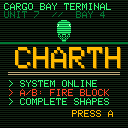
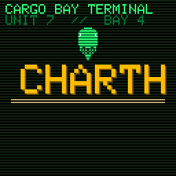

# CHarth





An original block-shooting puzzle game for [CHGame](https://github.com/bateske/CHGame). Shapes made of green blocks creep
down the screen towards your ship. Fire blocks up the columns to fill in the gaps, complete a whole shape and it
explodes. Thirty hand-drawn shapes, a terminal-style look and a psytrance loop on the piezo. Every line of game code, picture,
sprite and tune is original; the CHGame library in `chgame/` is by Kevin Bates.

## Controls

| Control | Action |
|---|---|
| Left / Right | Move the ship |
| A or B | Fire a block |
| Down (hold) | Hurry the shapes down, eight times as fast |
| START | Pause menu: resume, save game, return to title |
| START (hold 3 s) | Back to the CHGame menu |

## Rules

- A block you fire flies straight up your column and sticks under the lowest block there. If the column is empty it
  flies off the top and is lost.
- Every shape hangs from a flat top, so every gap in it is open from below and can be filled.
- A shape clears only when it has been **completed**: the rectangle around it must be completely full, at least 2 x 2.
  The whole shape then explodes. Bigger shapes score more (the score grows with the square of its size, times the level).
- A block fired into a shape that is already exploding sticks as a loose block, so stop firing on a column the moment
  the shape is done. Nothing falls when a shape clears.
- If any block reaches the bottom row, the game is over. The PROX gauge shows how close the shapes are, and the
  floor flashes red when they get near.
- Every four shapes cleared is a new level: the shapes creep faster, grow taller and wider, and from level 5 the gaps
  between them shrink.

## Shapes

The first two levels use only wide, flat shapes with a few small gaps, two to five shots each. Levels 3 and 4 mix in
simple arches and castles. From level 5 on come thirty designs: arches, castles, combs, pyramids, valleys, crowns,
twin towers, bridges and spikes, mirrored at random and getting a thicker top bar as the levels rise.

## Saving

The best score is saved on its own. A game in progress is saved at the start of each level and from the pause menu
(SAVE GAME). The title offers CONTINUE or NEW GAME when a save exists, and a lost game drops the saved game but keeps
the best score. If the board cannot save, the pause menu says SAVING IS OFF.

## Install

- **On the SD card:** copy `dist/CHarth.CHG` to `GAMES\GAMES\` on your CHGame's card.
- **As a package:** `dist/CHarth.chgame` installs through the CHGame tools (`chgame cart ...`).
- **Straight to the board:** `./cl upload` builds and flashes it.

## Building

Needs the CHGame board package and the tools in `chgame/` (vendored here). From this folder:

```
./cl build        compile and print the size
./cl upload       flash the board
./cl sim --free --frames 600 --png out/free --input "130:A,133:"    run it in the PC simulator
```

`./cl build -D=-DCHARTH_DEMO=1` is not for play: it adds the autoplayer that records `docs/gameplay.gif`.
The sprites come from `tools/sprites.py` (needs Python 3 with Pillow) (previews in `art/`) and the music from `tools/music.py`.

## Credits and licence

The game is MIT-licensed (see `LICENSE`). It is built on CHGame by Kevin Bates (bateske), Apache-2.0, vendored
unchanged in `chgame/`. The pixel art was drawn with a pixel-art generator and is covered by the same licence.
